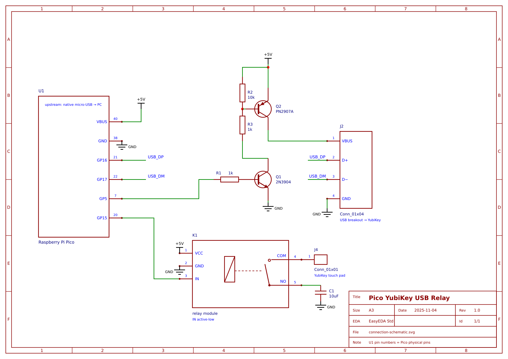

# Pico USB Relay for YubiKey

A Raspberry Pi Pico (CircuitPython) that sits between your PC and a YubiKey,
relaying FIDO2/WebAuthn traffic (and optionally OTP keystrokes) transparently.
On top of the transparent pipe it can optionally automate the two human
steps of FIDO2 — the PIN entry (Auto-UV) and the touch (auto-touch) — see
[Usage](#usage) and [plan.md](plan.md).

```
[ PC ] ──Pico's native micro-USB── [ Raspberry Pi Pico ] ──GP16/GP17 + VBUS── [ YubiKey ]
         (presents CTAPHID             (relay orchestrator,                   (physical
          HID device to the PC)         this code.py)                          token)
```

Full wiring — pinout, the GP5 dual-transistor power switch, and assembly
cautions — is in [SCHEMATIC.md](SCHEMATIC.md). The schematic sheet itself:



## Usage

### LED language

| LED | Meaning |
|---|---|
| slow blink | waiting for the YubiKey to attach (or power-cycling it) |
| fast blink (~8 Hz) | the YubiKey is waiting for a (real or simulated) touch |
| solid | relay attached and running |

### Plain relay (no Auto-UV)

Plug in and use: the PC sees a CTAPHID device, Chrome/luci prompt for the
FIDO2 PIN and touch exactly as with the key connected directly. Nothing
to run, nothing to configure.

### What Auto-UV automates

Two independent automations, both configurable in `src/config.py`:

**Auto-PIN — the persona + injector.** Arming runs the real CTAP2
clientPIN handshake with the YubiKey *once*, on the host (`autouv.py`
holds the PIN; the Pico never sees it), and caches the resulting
pinUvAuthToken on the Pico. From then on the relay presents the key to
Chrome as one with built-in biometric UV (GetInfo persona: `uv:true`,
no `clientPin`), so Chrome never shows a PIN dialog. When a ceremony
needs UV, the relay splices
`pinUvAuthParam = HMAC(token, clientDataHash)` into the request — the
key verifies it and sets `UV=true` itself, so relying parties receive a
genuine, key-signed UV bit. The PIN is used exactly once per arm, never
per ceremony. Knobs: `AUTOUV`, `AUTOUV_STICKY`, `UV_POLICY`,
`UV_RPIDS`.

**Auto-touch — the simulated finger.** When the key asks for user
presence (CTAPHID keepalive "waiting for touch"), the relay first waits
`AUTO_TOUCH_DELAY` (1 s) for your real finger — physically touching
the key always works and always wins. If nobody touches, GP15 pulls
the key's touch input low for `AUTO_TOUCH_HOLD` (1 s) and the ceremony
proceeds unattended. This is what makes UV-required flows (passkey
login, passwordless) fully hands-off. Knobs: `AUTO_TOUCH_DELAY`,
`AUTO_TOUCH_HOLD`.

Both act only while a token is live (see the re-arm signal below);
disarmed, the relay is a plain pipe with real PIN prompts and real
touches.

### Auto-UV (skip the Chrome PIN prompts)

One-time setup — put the FIDO2 PIN where the control script can read it
(never on the command line, which every local user can see in
`/proc/*/cmdline`):

```sh
echo 'your-pin' > .pin && chmod 600 .pin   # repo root; git-ignored
# or: export PICO_RELAY_PIN=...                # per-shell alternative
```

Day to day:

```sh
python3 utils/autouv.py            # ARM: acquire token, exit; persona stays on
python3 utils/autouv.py --goodbye  # DISARM: persona off, Chrome PIN prompts back
python3 utils/autouv.py --daemon   # optional: keep running, re-acquire on loss
```

- **Armed** (`AUTOUV_STICKY=True`, shipped): Chrome believes the key has
  built-in UV — no PIN dialog; assertions still carry genuine `UV=true`
  signed by the key. The token survives until the key re-attaches or
  power-cycles, or a GOODBYE is sent. No background process is needed.
- **The signal to re-arm**: Chrome suddenly shows PIN prompts again (the
  key was replug/power-cycled and the token died with it) — re-run
  `autouv.py`.
- **Disarming needs no PIN**: `--goodbye` returns before the PIN is ever
  read.
- `--daemon` is the belt-and-suspenders mode: it heartbeats and
  re-acquires automatically; Ctrl-C sends GOODBYE.

Read [plan.md §6](plan.md) before relying on this: while a token is
live, any process in your session can obtain `UV=true` assertions
without the PIN (the token is unscoped on this firmware). `UV_RPIDS` in
`src/config.py` can restrict which relying parties get injection.

### Everyday checks

```sh
make test          # CTAPHID INIT + PING through the relay
make unit          # host-side unit tests, no hardware
make log SECS=15   # watch the relay console (DIAG dumps, attach messages)
make deploy        # redeploy firmware after editing src/
```

### Troubleshooting quick hits

- **A ceremony failed once with a CTAPHID error** — the known ~5–10 %
  downstream packet-loss race; the relay already sent the client a clean
  retryable error. Just retry the ceremony. If it recurs, capture
  `make log` output when it happens (that is the open bug's missing
  evidence).
- **Chrome shows PIN prompts although Auto-UV was armed** — token lost
  (replug/power-cycle); re-run `autouv.py`.
- **`autouv.py` exits 2 (PIN rejected)** — fix `.pin`; it never retries
  (lockout safety), so the retry budget is intact.
- **Relay wedged after unplug/replug** — the self-heal should
  power-cycle the key within ~5 s; if the LED keeps slow-blinking,
  `make reset`.

## Files

| File | Purpose |
|---|---|
| `src/boot.py` | Defines the PC-facing USB device (CTAPHID or Keyboard). **Deploy to CIRCUITPY.** |
| `src/code.py` | The relay orchestrator: the whole program lives in `main(is_debug=False)`; all knobs live in config.py. **Deploy to CIRCUITPY.** |
| `src/config.py` | All relay configuration: pin assignment (`PIN_POWER`/`PIN_SIM_TOUCH`/`PIN_USB_DP`/`PIN_USB_DM`/`PIN_LED`), protocol facts, timing, downstream allowlist (`ALLOWED_VIDS`), Auto-UV switches (`AUTOUV`/`UV_POLICY`/`UV_RPIDS`), `IS_DEBUG` packet tracing. **Deploy to CIRCUITPY** (edit the deployed copy to tweak — code.py auto-reloads) |
| `src/lib/adafruit_usb_host_descriptors.py` | Descriptor parsing helper. **Deploy to CIRCUITPY/lib.** |
| `src/lib/ctaphid_proxy.py` | CTAPHID message-layer proxy: reassembles CTAP2/CBOR (`0x90`) messages and re-packetizes them through the identity hooks in `code.py` (Auto-UV phases 2–4 install the persona/injector there). **Deploy to CIRCUITPY/lib.** |
| `src/lib/cbor_min.py` | Minimal canonical CTAP2 CBOR codec (Auto-UV), with a nesting-depth cap. **Deploy to CIRCUITPY/lib.** |
| `src/lib/persona.py` | GetInfo persona: rewrites responses so the host sees a biometric key (no PIN dialog). **Deploy to CIRCUITPY/lib.** |
| `src/lib/injector.py` | Auto-UV injector: strips `options.uv`, splices `pinUvAuthParam = HMAC(token, clientDataHash)`; `UV_POLICY`/`UV_RPIDS` knobs in config.py. **Deploy to CIRCUITPY/lib.** |
| `src/lib/sha256.py` | Pure-Python SHA-256 (the RP2040 CircuitPython build has no `hashlib.sha256`). **Deploy to CIRCUITPY/lib.** |
| `src/lib/token_service.py` | Pico side of the Auto-UV token service: CDC protocol (ttyACM1), private-channel broker, token cache. **Deploy to CIRCUITPY/lib.** |
| `utils/autouv.py` | Auto-UV control: arms the persona (default: acquire the pinUvAuthToken through the relay, push it, exit — with `AUTOUV_STICKY=True` it stays on until the key re-attaches or a GOODBYE), `--daemon` keeps a heartbeat loop, `--goodbye` disarms without reading the PIN. Needs `pyserial` + `cryptography`; PIN from `PICO_RELAY_PIN`, `.pin`, or getpass — never a CLI flag. |
| `plan.md` | Design doc: Auto-UV (PIN auto-entry) — architecture, verified spec facts (phase-0 probes), phased implementation plan |
| `test/test_ctaphid.py` | Host-side verification: CTAPHID INIT + multi-packet PING through the relay (hardware) |
| `test/test_persona.py`, `test/test_injector.py`, `test/test_ctaphid_proxy.py`, `test/test_token_service.py` | Host-runnable unit tests (no hardware): `make unit` |
| `test/e2e_test.py` | Deploys code (default: production `src/code.py`), reloads the board, runs CTAPHID INIT/PING checks (helpers imported from `test_ctaphid.py`), captures the relay log |
| `utils/read_repl.py` / `utils/send_repl.py` / `utils/listen_repl.py` | Serial console helpers for /dev/ttyACM0 |
| `SCHEMATIC.md` | Connection schematic: pinout, power-switch circuit, cautions |
| `70-pico-yubikey-relay.rules` | udev rule so browsers/tests can access the relay's hidraw node |
Firmware images (`circuitpython-pico-*.uf2`) are git-ignored; fetch the
pinned version with `make download` (or another via
`make download VERSION=11.0.0-alpha.2`) from
[circuitpython.org](https://circuitpython.org/board/raspberry_pi_pico/).

## Deployment

1. Flash CircuitPython **10.3.1** for Raspberry Pi Pico (BOOTSEL mode, copy
   the .uf2 — a copy is saved here as `circuitpython-pico-10.3.1.uf2`).
   **Do not use 11.0.0-alpha.2**: it fixes the cold-boot attach issue
   ([circuitpython#8886]) but was observed to wedge the whole native USB
   stack (board vanishes from the bus) after YubiKey unplug/replug cycles.
   Revisit when 11.x reaches beta/stable.
2. Deploy the sources: `make deploy` (boot.py, code.py and lib/ to CIRCUITPY;
   after a fresh flash also run `make reset` so boot.py takes effect).
3. **Hard-reset the Pico** (replug or `microcontroller.reset()`), then plug
   the YubiKey in once the LED is blinking (10.3.1 misses a device attached
   around host init; hot-plug after boot is reliable).
4. Install the udev rule (one time, for browser access): `make install-rules`

5. Verify: `make test` → should print INIT + PING ok (or `make e2e` for the
   full deploy-reload-verify pipeline).

## Make targets

| Target | Purpose |
|---|---|
| `make deploy` | Copy `src/boot.py`, `src/code.py`, `src/config.py`, `src/lib/` to CIRCUITPY (code auto-reloads) |
| `make deploy-debug` | Deploy with packet tracing enabled (flips `IS_DEBUG` in the deployed config.py) |
| `make reset` | Hard-reset the board; applies boot.py changes, GP5 re-attaches the YubiKey |
| `make download [VERSION=10.3.1]` | Fetch a CircuitPython uf2 image (git-ignored) |
| `make install-rules` / `make remove-rules` | Install / remove the udev hidraw-access rule (sudo; idempotent) |
| `make flash UF2=<file>` | Flash firmware (Pico in BOOTSEL mode; RPI-RP2 drive must be mounted) |
| `make test` | Host-side CTAPHID verification against the running relay |
| `make e2e` | Full pipeline: deploy production code, soft-reload, verify, capture the relay log |
| `make log SECS=15` | Passively listen to the relay serial console |
| `make clean` | Remove Python cache dirs |

Redeploy code changes with `make deploy`; for a traced run use
`make deploy-debug` (logs packet headers to the serial console) and
restore production code afterwards with `make deploy`.

[circuitpython#8886]: https://github.com/adafruit/circuitpython/issues/8886

## Hardware cautions (learned the hard way)

- **Plug the Pico directly into a PC root port, not a hub.** A flaky hub
  caused enumeration timeouts and may have contributed to a firmware crash
  that left the board unreachable until a cold power cycle.
- **Downstream 5V is switched by GP5** through a dual-transistor high-side
  switch (NPN driver + PN2907A; circuit and values in
  [SCHEMATIC.md](SCHEMATIC.md)). The pin floats at boot and during flashing,
  so the YubiKey is unpowered until code.py enables it after the USB host
  port is initialized - this sidesteps the CircuitPython cold-boot bug
  (#8886) and lets the firmware power-cycle the device to self-heal.
- The breakout's VBUS line (Pico pin 40) **back-powers the board** through
  the VSYS diode when the switch is on. To hard-reset the Pico itself,
  unplug the PC side - or drive GP5 low / disconnect the breakout first -
  otherwise BOOTSEL is ignored (sampled only at power-on).

## Operating modes (boot.py)

CircuitPython multiplexes **all** `usb_hid` devices onto a single USB HID
interface, and CTAPHID requires unnumbered fixed 64-byte reports. Adding the
standard Keyboard (which uses report ID 1) makes hosts mis-parse every CTAPHID
packet (Chrome rejects report-ID-0 writes outright), so the two relay functions
are mutually exclusive:

- `MODE = "ctaphid"` (default) — FIDO2 / WebAuthn relay
- `MODE = "keyboard"` — OTP keystroke relay only (no BIOS boot-protocol
  support: CircuitPython requires a boot keyboard on interface #0, which
  conflicts with CDC/MSC and puts the board in safe mode)

A true composite Keyboard + CTAPHID device needs a second HID interface, which
CircuitPython cannot express; that would require C-level firmware (e.g. a
TinyUSB-based build like the Feather RP2040 USB Host's Arduino offering).

## How the relay works (code.py)

- **Downstream**: PIO USB host on GP16 (D+) / GP17 (D-) enumerates the YubiKey,
  finds the CTAPHID HID interface (64-byte IN/OUT endpoints) and the boot
  keyboard interface, ignores CCID. Replug and bus errors re-enumerate safely.
- **Upstream**: the CTAPHID device from boot.py; `get_last_received_report()`
  yields each host OUT report exactly once; `send_report()` pushes IN reports.
- **Orchestrator**: a CTAPHID-aware state machine.
  - The host's HID endpoints use bInterval=8ms and CircuitPython buffers only
    the *latest* OUT report, so while the host streams a multi-packet request
    the loop keeps reads at 2 ms (drain priority).
  - The INIT packet's `bcnt` tells how many CONT packets follow; once the
    request is complete the read window opens to 50 ms so the YubiKey's reply
    (1-3 ms) lands inside the wait — expiring a read with data in flight can
    corrupt the stream, and short reads would abort exactly then.
  - Response `bcnt` is parsed symmetrically; when the transaction completes the
    loop drops back to drain priority so the next request is never starved.
- CTAPHID channel IDs stay end-to-end between the host and the YubiKey — the
  relay is a transparent pipe and keeps no protocol state beyond pacing.

## Known limitations

- **Keyboard (OTP) and CTAPHID cannot run simultaneously** (see modes above).
- **Onboard LED status**: slow blink = waiting for the YubiKey or power-
  cycling it, fast blink = the YubiKey is waiting for a user touch
  (detected from CTAPHID KEEPALIVE packets), solid = relay attached and
  running.
- A short read timeout can abort a transfer exactly as data lands, surfacing
  as a bare USBError; the loop retries these and only tears down after six
  consecutive errors (a real device fault). After the teardown it
  power-cycles the YubiKey if nothing re-enumerates within 5 s, and also
  after three rapid fault teardowns even if the device still enumerates.
- The YubiKey 5.4.3's PING echo is unreliable for payloads needing 2+ CONT
  packets even when connected directly (verified against the bare device);
  real CTAP2 traffic is unaffected. The test suite uses a 100-byte PING.
- Host writes shorter than 64 bytes are silently dropped by CircuitPython
  (`out_report_lengths` mismatch). Real CTAPHID stacks always write 64.
- **Downstream allowlist**: only Yubico devices (VID 0x1050) are relayed
  (`ALLOWED_VIDS` in config.py). The PC always sees the Pico's identity
  upstream, so host-side policies cannot distinguish the downstream
  device — this allowlist is that gate. Extend the tuple for other keys.
- **udev rule breadth**: the rule matches every stock-CircuitPython Pico
  (239a:80f4), not just this relay; it grants hidraw access to the seated
  user only.
- **Keyboard mode is a keystroke-injection bridge by design**: whatever
  the downstream (allowlisted) device reports is typed verbatim into the
  host. Treat the breakout connection as keyboard input.
- **Auto-UV security model (read before enabling)**: while a token is
  live, ANY process in the user's session can obtain `UV=true` assertions
  from the relayed key without knowing the PIN (the token is the legacy
  *unscoped* one — fw 5.4.3 rejects scoped tokens — and auto-touch supplies
  presence after 1 s). With `AUTOUV_STICKY=True` (shipped) that window is
  the key's power state — the daemon need not stay running; GOODBYE or any
  re-attach clears it. That is the deliberate convenience-for-assurance
  trade of this feature; `UV_RPIDS` in config.py can restrict injection to
  an allowlist of relying-party IDs. Unplugging the daemon (or Ctrl-C)
  restores PIN-based UV immediately.
- **Auto-UV is experimental pending the real-Chrome dry-run**: everything
  verified so far used python-fido2 probes and the luci reauth flow; the
  Chrome-on-webauthn.io pass (register/login/UV-required) has not been
  recorded yet.
- **Residual relay failure (~5–10% of ceremonies)**: a downstream read
  race can lose one packet of a multi-packet response; the relay then
  sends the client a clean CTAPHID `INVALID_SEQ` error and swallows the
  strays (visible as `DIAG: lost response packet` on the console with
  `make log`) instead of leaking them. The affected ceremony must be
  retried; root cause remains open.

## Verified

Automated (`python3 test/test_ctaphid.py`, re-runnable):

- CTAPHID INIT handshake through the relay (nonce echoed, protocol v2).
- 100-byte multi-packet PING echoed byte-intact through the relay, both
  directions (3/3 consecutive standalone runs on both 10.3.1 and
  11.0.0-alpha.2).

Manual (observed once by hand, no automated test):

- Cold-boot reliability: after `microcontroller.reset()` with the YubiKey
  attached, it re-enumerates with no replug (GP5 power sequencing; the same
  scenario deterministically required a replug before the switch existed).
- Real WebAuthn: Chrome `git credential-luci reauth` — device probe, 251-byte
  multi-packet GET_ASSERTION, KEEPALIVE touch-prompt stream, 229-byte signed
  assertion relayed back intact.
- Behavior identical to the YubiKey connected directly (side-by-side
  comparison at multiple payload sizes).
- LED status behavior; power-cycle self-heal after device removal.

Not tested at all: keyboard mode (OTP scancode relay) beyond startup.
